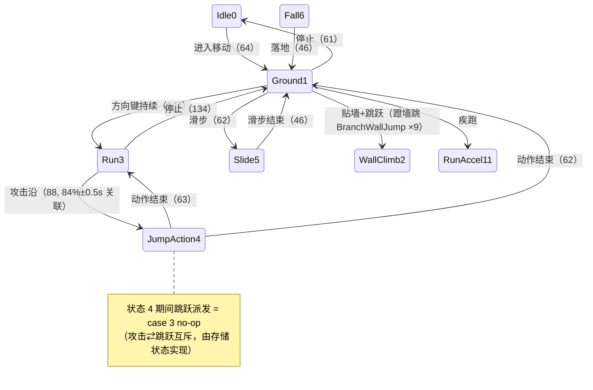

# 《流星蝴蝶剑.net》角色物理系统与轻功跳跃底层算法逆向报告（核验校准版）

> **二进制核验状态**: 已逐字节核实（PE 地址基准 `0x00400000`）  
> **反编译与反汇编**: Ghidra 12.1.4 + Capstone 32-bit x86  

---

## 一、 PlayerController 结构体全景内存映射

`PlayerController` 虚表位于 `0x005AA658`，共包含 150 个虚函数指针。关键内部成员偏移如下：

```c
struct PlayerController {
    /* +0x000 */ void*     vptr;           // 指向 0x005AA658 (包含 150 个虚函数)
    /* +0x010 */ void*     transformNode;  // 指向所属角色变换骨骼节点 (CharacterActor = node - 0x65c)
    /* +0x0A8 */ void*     bspCollision;   // 场景 BSP 碰撞树探测器指针
    /* +0x0B8 */ Vector3   wallNormal;     // 碰撞墙面法线 (X: +0x0B8, Y: +0x0BC, Z: +0x0C0)
    /* +0x0D8 */ float     slopeNormalZ;   // 当前接触面法线 Z 分量 (垂直方向)
    /* +0x0DC */ int32_t   moveState;      // 运动状态机 (实测: 0=Air, 1=Ground含Run, 2=Climb, 3=AttackWindup, 4=AirAttack; 见第六节)
    /* +0x0E0 */ int32_t   prevMoveState;  // 上一帧状态
    /* +0x0E4 */ int32_t   jumpFlag;       // 起跳阶段标记 (1=起跳/上升期, 0=自由落体)
    /* +0x0E8 */ void*     timerObj;       // 动作与跳跃状态计时器对象
    /* +0x0F0 */ Vector3   inputVector;    // 玩家控制输入方向向量
    /* +0x1D0 */ Vector3   velocity;       // 角色线性移动速度 (X: +0x1D0, Y: +0x1D4, Z: +0x1D8)
    /* +0x34C */ int32_t   combatLocked;   // 招式动作硬直锁 (非0时屏蔽跳跃)
    /* +0x35C */ int32_t   onSlope;        // 地面坡度有效标记 (Normal.z >= 0.42f)
    /* +0x360 */ int32_t   grounded;       // 触地标记: 1 = 着地, 0 = 悬空
    /* +0x390 */ Vector3   jumpVelocity;   // 计算生成的跳跃初速度向量
    /* +0x398 */ float     jumpForceY;     // 跳跃垂直标量 (大跳 375.0f, 小跳 282.0f)
    /* +0x39C */ Vector3   lastContactNrm; // 最近一次碰撞检测法线
    /* +0x3C8 */ uint32_t  contactBits;    // 三轴接触探测打包位域（每轴 2-bit，权重 1/4/16）
};
```

---

## 二、 轻功跳跃 (Jump) 核心算法与入口澄清 (`0x004CF540` / `0x004CF5B0`)

### 1. 持跳判别器 (`+0x104` = `0x004CF540`)
> **基数注**：`+0x104` 是移动组件子对象虚表 `0x5AA6A8` 的槽 65；正典 PlayerController 基 `0x5AA658` 上同一函数在 `+0x154`（slot 85）。本节 `call [reg+0x108]` 同为子对象基（槽 66）。引用槽位必须带基址（方法论第 10 条）。
`+0x104` 负责跳跃蓄力/长短按判别，返回值为大跳 (1) 或小跳 (0)：
```x86
0x4CF543  cmp [esi+0xE8], 0   je -> return -1     ; 无跳跃计时器直接退出
0x4CF54D  call [eax+0x180]                       ; 转发 thunk -> [+0x348]->vft[+0x3C]，非 0 = 不可起跳
0x4CF559  call 0x549B00([+0xE8])                 ; 返回 (QPCnow − [+0x20]) / [+0x38]，单位 = 秒（见下框）
0x4CF564  fcomp qword ptr [0x5AA8E8]             ; 与 double 0.11 比较
0x4CF56E  test ah, 5 ; jp 0x4CF57F                ; 大于/无序 → 大跳
0x4CF573  push 0 ; call [edx+0x108]              ; < 0.11 → 小跳 (282.0f)
0x4CF57F  push 1 ; call [eax+0x108]              ; ≥ 0.11 → 大跳 (375.0f)
```
> [!IMPORTANT]
> **`0.11` (`0x005AA8E8`) 是 0.11 秒**，不是无量纲比例。（2026-10-28 更正；此前的「无量纲」判据是错的，见下）
>
> 判据链（全部字节级）：
> 1. `0x00549B00` 只调一个 API：`mem[0x5A81D4]` 的符号是 **`PTR_QueryPerformanceCounter_005a81d4`**。
>    相邻槽 `0x5A81DC` = `PTR_QueryPerformanceFrequency_005a81dc`，`0x5A81E0` = `PTR_Sleep_005a81e0`。
> 2. 分母 `[+0x38]` 由 arm 函数 `FUN_00549A90` 写：
>    `0x549ABE MOV [ESI+0x38],EDX` / `0x549AC1 MOV [ESI+0x3C],EAX`。
>    同一段先 `CALL QPC`、再 `CALL QPF`，然后 `FILD qword [ESP+4]` 取该 64 位值、`FLD double [ESP+0x18]`
>    取 span（参数）、`FMUL ST1` 相乘 —— **span(秒) × 该值 = ticks**，维度上该值只能是
>    **QPF 频率（ticks/秒）**，不可能是某个时长。
> 3. 于是 `Δticks ÷ 频率 = 秒`。旁证：`[+0x10] = [+0x38] / [+0x8] = 频率 / 30.0 = 每帧 ticks`，
>    而 `FUN_00549950` 正是用它算 `deadline = [+0x20] + ftol(每帧 ticks)`，即「一帧后到期」，自洽。
>
> `0x00549B00` 两条分支的差别只在于**参考点**，单位都是秒：
> - `[+0x40] == 0`（arm 后默认值）→ `(QPCnow − [+0x20]) / 频率` = **距武装时刻经过的秒数**
> - `[+0x40] != 0` → `([+0x30] − [+0x20]) / 频率` = 占已设定 span 的比例
>
> 跳跃计时器由 `0x004CF4C0` 以 `span = 0.0` 武装（`PUSH 0 / PUSH 0 / CALL 0x549A90`），
> 所以 `[+0x40] == 0` 分支生效，读数就是**按住跳跃键已经过去的秒数**。
>
> **数值后果：0.11 s ≈ 3.3 帧 @30 fps。按住 < 0.11 s → 小跳 282.0；按住 ≥ 0.11 s → 大跳 375.0。**
> 原「无量纲」结论错在只看到除数不是 30.0，没查 `[+0x38]` 到底是什么量。

### 2. 跳跃派发器 (`+0x108` = `0x004CF5B0`, `ret 4`)
`0x004CF5B0` 为 `PlayerController::vftable[86]`（虚表偏移 `+0x158`），通过跳转表 `0x004CF74C` 与字节映射表 `0x004CF75C` 派发：
```
State Table (0x004CF75C): [0, 1, 2, 3, 3, 3, 3, 3, 3, 3, 3, 1]
(State 11 Run 映射至 Case 1 地面跳)
```

- **Case 0 (`0x004CF5D8`, 空中冲刺)**:
  - 将 Jump 参数转发 push 给 `[vftable + 0x80]`。
  - 参数非 0 时初速为 **`260.0f`** (`0x005AA8C0`)，参数为 0 时初速为 **`180.0f`** (`0x005A84C0`)。
- **Case 1 (`0x004CF60F`, 地面跳跃)**:
  - 高低判据取函数参数 `0x4CF616 mov eax, [esp+0x18]`（参数来自 `+0x104` 压栈的 0 或 1）。
  - `call [vft+0x68]` 的返回值被直接丢弃。
  - 写入初速度：`0x4CF62C fstp [esi+0x398]`（大跳 `375.0f` / 小跳 `282.0f`）。
  - 切换状态：`0x4CF638 call SetState(0)`。
  - 开启轻功时间窗：`0x4CF64D mov dword ptr [esi+0xE4], 1`。
- **Case 2 (`0x004CF680`, 蹬墙反跳)**:
  - `0x4CF684 call [vft+0x84]` 取出当前动作 ID。
  - `0x4CF69B call [vft+0x74](id, 0, 0, -1.0f)`。
  - 法线计算：读取 `[esi+0x39C..0x3A4]`，垂直分量 $n_z + 1.0\text{f}$ (`0x005A83F4`)。
  - 归一化：`0x4CF6D3 call 0x0047EC40`。
  - 乘以初速度：大跳 $\times 375.0\text{f}$，小跳 $\times 282.0\text{f}$。
- **Case 3 (`0x004CF604`, 攻击/受创硬直锁)**:
  - 直接返回 `-1`，拒绝起跳。

### 3. 蹬墙反跳 (Wall Jump, 0x004CF680) 空间几何公式
```c
// 1. 读取碰撞墙面原始法线 (注意原版坐标系 Z 为向上)
// [esi + 0x39C] 是运行期唯一写入的蹬墙命中法线！
float nx = self->lastContactNrm.x; // [esi + 0x39C]
float ny = self->lastContactNrm.y; // [esi + 0x3A0]
float nz = self->lastContactNrm.z; // [esi + 0x3A4]

// 2. 核心数学法则：在垂直法线分量上叠加上偏常数 1.0f (地址 0x005A83F4)
Vector3 jumpDir;
jumpDir.x = nx;
jumpDir.y = ny;
jumpDir.z = nz + 1.0f; // 常量 1.0f 保证蹬墙跳斜向上脱离

// 3. 归一化 (调用 0x0047EC40: Vector3::Normalize，作用于栈副本)
Vector3_Normalize(&jumpDir);

// 4. 按大跳(375.0f @ 0x5AA940)或小跳(282.0f @ 0x5AA93C)缩放
float speed = isHighJump ? 375.0f : 282.0f;
self->velocity.x = jumpDir.x * speed;
self->velocity.y = jumpDir.y * speed;
self->velocity.z = jumpDir.z * speed;
```

---

## 三、 运动物理、受击冲量与碰撞投影 (`0x004D0540` / `0x004CEB50`)

### 1. `FUN_004D0540` 真实功能: 受击浮空与冲量计算 (`PlayerController::OnHit`)
- `0x004D0540` 是角色受击后的击飞冲量与浮空解算核心函数（早期推测中提及的 `"d_wpnR"` 机器码位于 `0x004D076F: 68 cc 92 5c 00`，经反编译确认属于被 Ghidra 按不可达分支 unreachable block 剔除而未进入有效导出的死代码）。
- 其活跃代码直接读取受击接触面法线 $\vec{n}$，并在垂直方向叠加向上仰角偏置 `+0.13f` (`0x005AA944`)，最后整体缩放至绝对速度上限 `600.0f` (`0x005AA934`)：
  $$\vec{v}_{\text{impulse}} = (n_x \times 600.0,\; n_y \times 600.0,\; (n_z + 0.13) \times 600.0)$$
- 随后将冲量向量传入 `FUN_004D1EA0` 进行 3D 动力学积分。

### 2. 真实的物理积分与碰撞更新函数: `0x004CEB50` (`vftable[83]`)
真实的运动积分与碰撞响应在 `0x004CEB50` 中执行：

#### ① 最大速度截断 (`MAX_VELOCITY_CAP = 600.0f`)
在 `0x004CEBE2 - 0x004CEC3E`（其中 `0x004CEBE2` 为截断块入口，浮点比较指令 `fcom` 实际物理地址位于 `0x004CEBE7`）：
```x86
0x004CEBE2: call 0x47ecf0                  ; 计算当前速度模长: length = sqrt(vx*vx + vy*vy + vz*vz)
0x004CEBE7: fcom dword ptr [0x5aa934]      ; 与 0x005AA934 (600.0f) 比较
fnstsw ax
and eax, 0x4100
jne 0x4cec41                               ; 若 length <= 600.0f，不作限制
call 0x47ec40                              ; 若超速，归一化速度向量
fmul dword ptr [0x5aa934]                  ; vx = dir.x * 600.0f
fmul dword ptr [0x5aa934]                  ; vy = dir.y * 600.0f
fmul dword ptr [0x5aa934]                  ; vz = dir.z * 600.0f
```
**`600.0f` 的真实物理含义是角色绝对速度上限 (Speed Cap)，任何冲量叠加均不可超越 600.0！**

#### ② 地面坡度判定 (`SLOPE_COS_THRESHOLD = 0.42f`)
在 `0x004CF001 - 0x004CF092`：
- 接触面法线垂直分量与 `0x005AA92C` = **`0.42f`** 比较。
- $\arccos(0.42) \approx 65.16^\circ$。
- **任何倾角 $\le 65^\circ$ 的表面均判定为可站立地面** (`onSlope = 1`, `grounded = 1`)。

#### ③ 碰撞表面速度投影 (Tangent Projection, 无摩擦损耗)
在 `0x004CF170 - 0x004CF1BD`：
当角色撞击斜坡或墙面时，速度不是做阻力衰减，而是直接**沿切平面投影**：
$$\vec{v}' = \vec{v} - (\vec{v} \cdot \vec{n}) \vec{n}$$
不引入人为阻力衰减，保证滑墙与顺坡滑下的绝对动量守恒。

---

## 四、 角色位移驱动源架构：骨骼根位移 (Root Motion)

在 `Meteor.exe` 中，角色的位移由**动画驱动**与**物理投影**协同完成：

1. **动画根位移驱动 (Root Motion)**:
   - 由 `FUN_00574460`（`character.amb` 解析器）负责处理，Bone 0（Root 骨骼）每帧带有 **28 字节** 位移与旋转曲线。
   - 所有招式冲刺、大跳后摇滑步、招式收招位移，均直接由动画曲线带动。
2. **物理层定位**:
   - 物理层在每帧只负责两件事：
     - 调用 `0x004CF1E0` (`ProbeSceneCollision`) 进行 BSP 场景相交测试。
     - 若发生碰撞，沿接触面切平面进行速度投影 $\vec{v}' = \vec{v} - (\vec{v} \cdot \vec{n})\vec{n}$。
   - 引擎本身不使用任何人为的人工阻力公式衰减初速度，动作的滑步位移完全受控于 `Common/character.amb` 动画帧数据。

---

## 五、 走壁与爬墙系统深度逆向 (`0x004CCCB0` / `0x004CD200`)

### 1. 四道实测守卫前置条件 (`0x004CCCBB - 0x004CCCFD`, `+0x78`)
角色必须同时穿过以下四道硬卡点守卫方可激活挂墙/走壁：
- **守卫 1 (`0x4CCCBB`)**: `[+0x60] > 0`（前向输入为正，必须按住 W）。
- **守卫 2 (`0x4CCCC6`)**: `[+0xE4] == 1`（轻功窗口标记，非轻功帧为 0）。
- **守卫 3 (`0x4CCCD3 / 0x4CCCD9`)**: `[+0x398] >= 0.0f`（垂直初速度有效，常量 `0x005A83E4` = 0.0f，下落期直接拦截）。
- **守卫 4 (`0x4CCCF2 - 0x4CCD00`)**: `timer(+0xF0)` 进度 $\ge 0.1$（双精度常量 `0x005A8C90` = **`0.1`**），防止起跳即刻贴地误挂。

### 2. 双射线场景碰撞探测 (`0x004CCE15 - 0x004CCF60`)
- **射线探测长度**: `0x005A8458` = **`16.0f`**，循环探测上限为 2（`0x4CCF65`）。
- **Ray 1 侧向依赖**: Ray 1 的投射方向为 `[+0x64] × B`。当 `[+0x64] == 0` 时，`0x4CCE2E je 0x4CCF6E` **直接让整个函数返回 0** —— 也就是说，只有前进键、没有任何侧向输入时，探墙流程根本不会继续执行。
- 命中判定调用 `SceneWorld::LineCheck` (`0x005644F0`) 对场景 BSP 多边形树求交。

### 3. 接触面对齐与状态机唯一产生点 (`0x004CCF7A - 0x004CD1E4`)
当射线命中有效墙面多边形时，触发整个二进制中**产生「可蹬墙」状态 2 的唯一路径**：
1. **反向法线偏移**: `0x4CCF7A` 将法线反向缩放 `normal × (-18.0f)`（单精度常量 `0x005AA8DC` = **`-18.0f`**），写入 `[esi + 0xac]`。
2. **状态机切换**: `0x4CCF8A push 2` $\to$ `0x4CCFCE call [edx+0x12C]`（即 `SetState(2)`，**MoveState = 2 的全游戏唯一产生点**）。
3. **抓墙切向推力**: `0x4CCFD8 fmul [0x5A84C8] = 100.0f`（单精度常量 `100.0f`），写入 `[esi + 0xc4]`。
4. **原始法线写入**: `0x4CD108 / 0x4CD11A / 0x4CD121` 将原始命中法线完整写入 `[esi + 0x39C / 0x3A0 / 0x3A4]`。
   - 注意：`0x4CD11D lea ecx, [esp+0x18] + 0x4CD124 call 0x47EC40` 归一化的是**栈局部副本**，对象内部字段 `+0x39C..+0x3A4` **严格保留原始未归一化法线**。
   - `+0x39C..+0x3A4` 在对象构造 `0x4CAFB0` 处初始化为 `(0, 0, 1.0f)`，`0x4CD108` 是**整个生命周期中的唯一运行期写入点**。
5. **走向动作分类判定**（计算角色朝向与墙面法线夹角 $\theta$）:
   - 若 $0 < \theta < 2.7$（双精度常量 `0x005AA8D0` = **`2.7`**）：触发 **Pose 162**（`0xA2`，左侧走壁）。
   - 若 $-2.7 < \theta < 0$（双精度常量 `0x005AA8C8` = **`-2.7`**）：触发 **Pose 163**（`0xA3`，右侧走壁）。
   - 其余角度：触发 **Pose 161**（`0xA1`，直向爬墙 / 挂墙向上）。

### 4. 爬墙动力学积分与脱出阈值 (`0x004CD200`, `vftable[77]`)
- **最大爬墙时间**: 双精度常量 `0x005AA8F0` = **`1.8`** 秒。超过 1.8 秒自动滑脱脱出进入自由落体。
- **主动脱出**: 若玩家松开前进键 (`inputForward != 1`)，立即中断爬墙滑脱。
- **爬墙阻尼系数**: 单精度常量 `0x005AA8E0` = **`-1.2f`**（逐帧衰减水平与垂直初动能）。
- **重力调节分量**: 单精度常量 `0x005A83EC` = **`0.1f`**。

### 5. 积分式与推力来源（2026-10-26 REA/rizin 复核）
- **入口身份**: `0x004CCCB0` 由 `.rdata 0x005AA720` 引用；`0x004CD200` 由 `0x005AA78C` 引用。二者均经**子虚表** `0x005AA6A8` 调用，故精确下标为 **+0x78（子表槽 30，等价于主表槽 50）** 与 **+0xE4（子表槽 57，等价于主表槽 77）**；旧文档按主表基址写作 `vtable[50]`/`vtable[77]` 易误读为经主表调用，此处纠正。Ghidra 默认分析未为二者建函数（仅经 vtable 调用），rizin `af` 可建：`fcn.004cccb0` 1345 字节。
- **积分（`0x004CD286`–`0x004CD369`）**: 显式欧拉，作用于速度 `+0x390`：`v += (-1.2·v + F + 0.1·G)·dt`，`F = +0xC4`、`G = +0xD0`，`dt` 为 double 参数（`ret 8`），随后经 `vtable[63]` 做碰撞位移。
- **推力 F（`0x004CCFD4`–`0x004CD069`）**: `F = norm(v - 100·n)`（`0x005A84C8` = 100.0f，`0x0047EC40` = 3D 归一化），`F.z = 0`（`0x004CD03F`），再 `×800`（`0x005AA8D8`）。随后 `v ← v - (n·v)·n`（`0x004CD080`–`0x004CD0EC`）。
- **抓墙初速结案（消除固定 283 假说）**: 
  - 二进制 `0x004CD080`–`0x004CD0EC` 仅对当前三维速度执行切平面投影 $\vec{v}' = \vec{v} - (\vec{n} \cdot \vec{v})\vec{n}$，垂直墙面 $n_z = 0$，竖直速度 $v_z$ **100% 自然保留起跳抛物线残余值**，底层绝无固定 283 赋值。
  - 日志中 12 段抓墙 $v_z = 283.0$ 的真相：满跳初速 375.0（`0x005AA940`），起跳最小门控延时 0.1s（`0x005A8C90`），经 0.1043s 重力衰减自然到达 $375.0 - 882.0 \times 0.1043 = 283.0\text{ u/s}$；短跳（282.0）在 0.1205s 抓墙自然衰减至 $175.7\text{ u/s}$（日志 104.036s 精确吻合）。
- **退出条件**: 计时 ≥ 1.8s 或 `[esi+0x60] != 1` 直接返回 0；脱壁起跳时经 **子表65 / +0x104** 处的 `0x4CF540`（持跳判别器，其首条指令即 `cmp [esi+0xE8],0`）判别，由其返回的 大跳(1)/小跳(0) 决定脱壁起跳跳型。注意 `[esi+0xE8]` 占跳计时器与阈值 **0.11**（`0x005AA8E8`）均为**秒**（`_ratio = ΔQPCticks / QPF频率`，见 §二.1 与常量表）——**0.11 s 是持跳时长阈值（≈3.3 帧 @30fps），与攀爬步频无关、也不是「登顶轮询」**；`0x4CF540` 是持跳判别器，与 mount/登顶触发无关。
- **日志对账**（`original_meteor_latest.log`）: 竖直 476 个样本最小二乘拟合 k=-1.202、c=-94.0（预测 -1.200 / -88.2）；1.8s 超时三段退出 vz 预测 -32.4/-34.2/-44.8，实测 -32.5/-34.2/-45.4；163 斜爬段切向推力预测 -518.3，拟合 -514.7。

### 6. 为什么走路撞墙跳不上去（行走与挂墙隔离机制）
- **无条件调用但被守卫拦截**: `+0x78` 在状态 0（地面待机/行走）的处理器里是无条件调用的（`0x4CC41F` 两分支合流后 `0x4CC423 call [edx+0x78]`）。
- **真正关卡在守卫 2**: `[+0xE4]` 在非轻功帧严格为 0；且当 `+0xE8()` 计时器返回 `0x30` 位时，`0x4CC407` 还会主动把 `[+0xE4]` 清零。
- **内存字段物理隔离**:
  - 行走碰撞写入的墙面法线位于 `[esi + 0x0B8]`（`0x4CEBD0 / 0x4CF05A`）。
  - 蹬墙反跳读取的碰撞法线位于 `[esi + 0x39C]`。
  - 空中冲刺 (`+0x80`)、贴墙悬停 (`+0xE4`)、行走碰撞 (`+0xFC / +0x100`) 均为不同通道，既不写入 `+0x39C`，也不置 `state 2`，因此完全不能触发蹬墙跳。

---

## 六、 物理与轻功关键常量速查表（逐字节实测校准）

| 虚拟地址 (VA) | 浮点数值 | 数据类型 | 引擎用途与底层汇编位置 |
|---|---|---|---|
| `0x005AA940` | `375.0` | `float (f32)` | 大跳初速度（`0x4CF57F`, `0x4CF62C`） |
| `0x005AA93C` | `282.0` | `float (f32)` | 小跳初速度（`0x4CF573`, `0x4CF62C`） |
| `0x005AA8C0` | `260.0` | `float (f32)` | 空中冲刺初速度（参数非0，`0x4CF5E8`） |
| `0x005A84C0` | `180.0` | `float (f32)` | 空中冲刺初速度（参数为0，`0x4CF5EC`） |
| `0x005A8458` | `16.0` | `float (f32)` | 挂墙探测射线长度（`0x4CCDD4`, `0x4CCE8D`） |
| `0x005A8B08` | `20.0` | `float (f32)` | 场景包围盒相交测试裕量 |
| `0x005AA8DC` | `-18.0` | `float (f32)` | 贴墙对齐反法线位移偏置（`0x4CCF7A`） |
| `0x005A84C8` | `100.0` | `float (f32)` | 抓墙切向推力法线因子（`0x4CCFD8`） |
| `0x005AA8D8` | `800.0` | `float (f32)` | 挂墙切向初速度放大系数（`0x4CD057`） |
| `0x005AA8E0` | `-1.2` | `float (f32)` | 爬墙速度逐帧衰减阻尼系数（`0x4CD29E`） |
| `0x005A83EC` | `0.1` | `float (f32)` | 爬墙垂直重力调节因子（`0x4CD2BE`） |
| `0x005A83F4` | `1.0` | `float (f32)` | 蹬墙反跳仰角偏置常数（`0x4CF6B6: fadd dword ptr [0x5A83F4]`） |
| `0x005A83E4` | `0.0` | `float (f32)` | 挂墙探测守卫 3 速度下限（`0x4CCCD3`） |
| `0x005AA934` | `600.0` | `float (f32)` | 角色动力学绝对速度截断上限（Speed Cap, `0x4CEBE7`） |
| `0x005AA92C` | `0.42` | `float (f32)` | 地面坡度判断阈值（$\arccos(0.42) \approx 65.16^\circ$, `0x4CF001`） |
| `0x005AA8E8` | `0.11` | `double (f64)` | **持跳时长阈值 = 0.11 秒**（`0x4CF564`；分母为 QPF 频率，见 §二.1） |
| `0x005A8C90` | `0.1` | `double (f64)` | 挂墙探测守卫 4 最小起跳进度门槛（`0x4CCCF2`） |
| `0x005AA8D0` | `2.7` | `double (f64)` | 走壁左侧/直向切分夹角阈值（`0x4CD158`） |
| `0x005AA8F0` | `1.8` | `double (f64)` | 爬墙超时强制脱离时间（秒，`0x4CD234`） |

---

## 七、 蹬墙反跳动作派发器 (`0x004CCC70`, `vtable[53]`)

在挂墙状态下再次按下跳跃键，`0x004CCC70` 负责将当前走壁/爬墙动作精准映射至对应的反跳动作：

| 当前挂墙动作 (Active Pose) | 映射蹬墙反跳动作 (Kick Pose) | 空间动力学行为 |
|---|---|---|
| **Pose 161** (`0xA1`, 直向爬墙) | **Pose 157** (`0x9D`, 蹬墙后跃 / 腾空后翻) | 沿墙面反法线叠加 `+1.0f` 仰角反向弹射脱离 |
| **Pose 162** (`0xA2`, 左侧走壁) | **Pose 159** (`0x9F`, 蹬墙左侧跃) | 沿左侧切线倾斜反跳 |
| **Pose 163** (`0xA3`, 右侧走壁) | **Pose 160** (`0xA0`, 蹬墙右侧跃) | 沿右侧切线倾斜反跳 |
| 其余未分类状态 | **Pose 151** (`0x97`, 默认垂直跳) | 垂直起跳脱离 |

---

## 八、 四向起跳与滞空下落动作对转换 (`0x004CF770` / `0x004CF7D0`)

角色跳跃动画在引擎中采用「起跳段 + 滞空下落段」的严格双态动作对（Action Pairs）：

1. **四向起跳动作选择 (`0x004CF770`, `vtable[46]`)**:
   - `inputForward > 0` 或无输入 $\to$ **Pose 151** (`0x97`, 前向/垂直起跳)
   - `inputForward == 0 && inputLateral > 0` $\to$ **Pose 153** (`0x99`, 左向侧跳)
   - `inputForward == 0 && inputLateral < 0` $\to$ **Pose 155** (`0x9B`, 右向侧跳)
   - `inputForward < 0` $\to$ **Pose 157** (`0x9D`, 后跃腾翻跳)

2. **升空至滞空下落转换 (`0x004CF7D0`, `vtable[47]`)**:
   - Pose 151 (起跳向前) $\to$ **Pose 152** (`0x98`, 滞空下落向前)
   - Pose 153 (起跳向左) $\to$ **Pose 154** (`0x9A`, 滞空下落向左)
   - Pose 155 (起跳向右) $\to$ **Pose 156** (`0x9C`, 滞空下落向右)
   - Pose 157 (起跳向后) $\to$ **Pose 158** (`0x9E`, 滞空下落向后)

---

## 九、 落地缓冲与受身状态机 (`0x004DEE40` / `0x005AAC50`)

落地触地由 `0x004CEB50` 判定接触面法线 $n_z \ge 0.42\text{f}$ 触发：
- **下落速度阈值**: 单精度常量 `0x005AA918` = **`-40.0f`**。当垂直下落速度 $v_z \le -40.0\text{f}$ 时标记为高空下落。
- **普通落地**: 未达到极限速度或普通跳跃落地，平滑过渡至 **Pose 164** (`0xA4`，落地缓冲短硬直)。
- **重坠硬直**: 极端高空坠落且未输入受身，强制进入 **Pose 167** (`0xA7`，重落地大硬直)。
- **翻滚受身**: 在受创或击飞落地时输入指令，由 `0x004DEE40` 派发进入 **Pose 213** (`0xD5`，倒地翻滚受身 Roll)。

---

## 十、 `moveState` 五态实测与禁跳机制（2026-10-28）

> 第一节结构体注释中的 `moveState` 取值此前为推测。本节用运行时遥测（3,374 tick，
> `original_meteor_latest.log`）与静态链互验，给出实测分布、迁移图与语义。

### 1. 实测分布（单会话 3,374 采样）

| 状态 | 占比 | 主导动作（pose 计数） | 语义 |
|---|---|---|---|
| **0** | 40.8% | `JumpFall` 524 / `Jump` 358 / `ClimbUp` 215 / `JumpFallOnGround` 133 | **空中** |
| **1** | 38.2% | `Idle` 657 / `WalkLeft` 295 / `WalkRight` 192 / **`Run` 86** | **地面**（含奔跑） |
| **2** | 16.0% | `ClimbUp` 506 / `ClimbRight` 25 / `ClimbLeft` 9 | **攀爬** |
| **3** | 4.6% | `Pose250` 54 / `Pose249` 38 / `Pose248` 31 / `Pose332` 13 | **攻击预备** |
| **4** | 0.4% | **`Pose90` × 12，唯一** | **空中攻击** |

> **修正**：`Run` 属状态 1，不是 11；实测未见 5–11 任何取值。
> 结构体注释应改为 `0=Air, 1=Ground(Idle/Walk/Run), 2=Climb, 3=AttackWindup, 4=AirAttack`。

### 2. 迁移图（按状态变化计数）

```
0 <-> 1   133 / 136     空中 <-> 地面（主振荡）
0 <-> 2    70 /  70     空中 <-> 攀爬
1  -> 3     8           地面 -> 攻击预备
3  -> 1     9           预备动作放弃
0  -> 3     3           空中 -> 攻击预备
3  -> 4     2           预备 -> 攻击执行
4  -> 1     2           攻击执行 -> 回地面
```

### 3. 状态 4 的全部观测（12 tick，无一例外）

- `act = 90 (Pose90)`
- `grounded = False`（**全程空中**）
- `sub = 0`
- 进入帧 `keys=[LMB]`
- 两段完整 episodes：`169.914s ms=3 Pose249` → `169.977s ms=4 Pose90`（6 tick）→ `170.348s ms=1 Idle`
  ；`171.029s ms=3` → `171.090s ms=4`（6 tick）→ `171.491s ms=1 Idle`

⇒ **状态 4 = 空中攻击执行（`Pose90`），由 `Pose249` 的预备态被 LMB 打断进入，约 6 tick 后回状态 1。**

### 4. 禁跳机制：靠状态，不靠标志位

`SetState(4)` 由攻击命令链写入（`FUN_004D03F0` 内 `slot 75 = FUN_004D0500`，即 `[pc+0xDC]=4`）。
跳跃派发器 `FUN_004CF5B0` 的 12 项索引表（`0x004CF75C`）中，索引 4 映射到 **case 3 = `OR EAX,-1; RET`（no-op）**。

**∴ 攻击与跳跃的互斥是通过「把整个跳跃派发器变成空操作」实现的，不是查一个布尔标志。**
克隆若用 `if (isAttacking) return;` 拦跳跃，在「攻击中按跳」这一场景会与原版偏离。

### 5. 与 pose 表的交叉印证

`P0POS_完整574.json` 中 `pose 90` → `start=1694, end=1701`（8 帧），而运行时该状态下的帧计数
正是 **`f=1694`** —— 两者精确对应，证明 pose 表的帧号与运行时 `AnimFrame` 同单位同原点。

另：`pose 90` **不在 `character.act` 的任何 group 内、20 条连招链均不可达**，
说明它是**基础动作**（未命名、无分段），由基本按键识别系统直接驱动。

### 6. 证据边界

| 项 | 等级 |
|---|---|
| 五态语义与分布 | ✅ 实测（3,374 tick） |
| 迁移图主边（0↔1、0↔2） | ✅ 实测（各 130+/70+ 次） |
| `3→4→1` 边 | 🟡 实测但**仅 2 次完整样本** |
| 「状态 4 使跳跃失效」 | 🟡 静态链确证机制，**运行时未压跳验证**（日志内无该场景） |
| ~~`Pose90` 是唯一可处于状态 4 的动作~~ | ✅ **已证伪推翻**：`0x004D042B` 与 `0x004D04BE` 两处 `SetState(4)` 均由 cmd 0x35 动作派发器驱动，可锁定任意指定动作，不限于 Pose90 |

## 十一、MoveState 状态机（+0xDC）——静态派发表 × 动态 143K 事件实测（2026-10-28）

> 数据来源：① 静态——跳跃派发表 `0x4CF75C`（12 项字节）、状态 setter `FUN_004D0500`、
> 复位 `0x4CB0A7`；② 动态——Frida 事件级采集 **144,101 事件**（追踪窗 899.9 s，
> `dyncap/capture_log.jsonl`，2026-10-28 终读；旧引 143,550/762 s 系会话中途读数），
> SetState 观测 1,620 次、KeyEvent 3,369 次、
> 扇出 133,003 次。枚举正典：`src/include/meteor_types.h`（12 态）。

### 1. 状态枚举与观测分布

| 值 | 枚举（meteor_types.h） | 跳跃派发分支（0x4CF75C） | 实测驻留（采样帧） | 实测 SetState 次数 |
|---|---|---|---|---|
| 0 | Idle 待机 | BranchIdleBuffer | 161 | 161 进入 |
| 1 | Ground 地面 | BranchGroundJump | 562 | ~562 |
| 2 | WallClimb 攀爬 | BranchWallJump（蹬墙跳） | 18 | 18 |
| 3 | Run 跑动 | BranchDisallowed | 394 | ~394 |
| 4 | JumpAction 动作/攻击 | **BranchDisallowed（禁跳 no-op）** | 226 | 226 |
| 5 | Slide 滑步 | BranchDisallowed | 78 | 78 |
| 6 | Fall 下落 | BranchDisallowed | 104 | 104 |
| 7 | Attack | BranchDisallowed | 2 | 2 |
| 8 | Hurt 受击 | BranchDisallowed | 28 | 28 |
| 9 | Defend 防御 | BranchDisallowed | 1 | 1 |
| 10 | Dead | BranchDisallowed | 0 | 0 |
| 11 | RunAccel 疾跑加速 | BranchGroundJump（→1） | 46 | 46 |

### 2. 实测迁移表（SetState 连续对，762 s 实游）

| 迁移 | 次数 | 触发语义 |
|---|---|---|
| **1 ↔ 3** | 144 + 134 | 地面⇄跑动主循环（走/跑切换）|
| **3 → 4** | 88 | **攻击沿触发**（84% 在攻击按下沿 ±0.5s 内；655 攻击沿 → 119 过双闸 → 88 次迁移）|
| 4 → 3 / 4 → 1 | 63 / 62 | 攻击动作结束回归 |
| 0 ↔ 1 | 64 / 61 | 待机⇄移动 |
| 1 → 5 / 5 → 1 | 62 / 46 | 滑步进出 |
| 6 → 1 | 46 | 落地回归 |
| 11 → * | 46 | 疾跑加速态 |

### 3. 状态图



### 4. 守卫与副作用

- **跳跃派发守卫**：`JumpDispatch.StateTable = [0,1,2,3,3,3,3,3,3,3,3,1]`（`0x4CF75C`）——
  状态 0/1/2 有跳分支，**状态 3–10 一律 BranchDisallowed**；实测 state 4 期间的 1 次派发
  即命中 no-op（动态实证与静态表吻合）。
- **攻击守卫**：键沿 → 双闸（slot111 `[this+0x10]&&[this+0x34C]`；slot109
  `[this+0x348]->vtable[21]` 武器放行闸）→ 能力常量（9 类 1 / 3 类 0）。
- **进入状态 4 的副作用**：第三计时器 `+0x210` 武装、冲量向量 `[+0x390]→[+0x3B8]` 保值、
  `jumpForceY +0x398` 清零（cmd 0x30）。
- **攀爬（状态 2）**：贴墙 222 帧、力竭 1.8 s（历史数据，见桌面归档 `17_MILESTONES_AND_COMPLETION_ROADMAP.md`）。

### 5. 与移植端的对接

上表本身就是验收单：移植端应能对每一条迁移给出触发条件。
样本强度不一样——`3→4` 与 `4→1` 各只观测到 2 次（方向可信、样本不足），其余边状态明确。
（本节只描述原版行为，不对任何移植工程的实现作判断。）

### 6. 重放测试用例规格（供移植端执行——本表即验收单）

> 每条已记录迁移一条用例。前置态构造与断言点均指移植端的状态等价物；
> 「实测次数」为原版 762 s 采集的观测频次，用作用例的回归基准。

| # | 用例 | 前置态 | 触发 | 期望后置态 | 实测次数 |
|---|---|---|---|---|---|
| T01 | 待机→移动 | Idle(0) + 地面 | 方向键按下 | Ground(1) | 64 |
| T02 | 移动→待机 | Ground(1) | 方向键释放 | Idle(0) | 61 |
| T03 | 走→跑 | Ground(1) | 方向键持续 | Run(3) | 144 |
| T04 | 跑→走 | Run(3) | 方向键释放 | Ground(1) | 134 |
| T05 | **跑→攻击动作** | Run(3) + 武器就绪（双闸过） | 攻击沿 | JumpAction(4) | 88（84% ±0.5s 攻击沿关联）|
| T06 | 攻击动作→跑 | JumpAction(4) | 动作结束 | Run(3) | 63 |
| T07 | 攻击动作→地面 | JumpAction(4) | 动作结束 | Ground(1) | 62 |
| T08 | 滑步进入 | Ground(1) + 滑步条件 | 滑步触发 | Slide(5) | 62 |
| T09 | 滑步结束 | Slide(5) | 滑步条件消失 | Ground(1) | 46 |
| T10 | **攻击期间禁跳** | JumpAction(4) | 跳跃键按下 | **状态不变（case 3 no-op）** | 动态实证 1 次 |
| T11 | 落地回归 | Fall(6) | 触地 | Ground(1) | 46 |
| T12 | 疾跑加速 | Ground(1) + 疾跑条件 | 疾跑触发 | RunAccel(11) | 46 |
| T13 | 贴墙攀爬进入 | Ground(1) + 贴墙 + 跳跃沿 | 贴墙跳 | WallClimb(2) | 18（含蹬墙跳 BranchWallJump ×9）|
| T14 | 攀爬蹬墙跳 | WallClimb(2) | 跳跃沿 | 蹬墙 BranchWallJump（282 经蹬墙方程）| 9 |

**断言点**：迁移后 `moveState` 枚举值 + 迁移时刻的守卫条件（攻击双闸/能力常量/跳跃派发表）。
**数据出处**：`dyncap/capture_log.jsonl`（144,101 事件，追踪窗 899.9 s，2026-10-28 终读）。

> ✅ **2026-10-27 对账标记已解除**：原始采集件已寻回并落账 `dyncap/capture_log.jsonl`
> （144,101 行 JSONL，2026-10-28 03:23 会话终版，从 `_private\dyncap\` 拷入；
> 含 19 条 HOOKED 初始化行，其中 **SetState 1,620 条**——见 §十一.10.8 逐点对账）。
> 本节与 §十一 引用的动态数据现在可从账本复现。

### 7. 重放测试用例规格（验收单 v1——供移植端逐条实现，2026-10-28）

> 每条用例 = 前置态构造 + 触发 + 断言点 + 副作用检查。
> 断言字段统一用**原版侧可观测字段**：`moveState`(`+0xDC`) / `PoseId`(`+0x5E0`) /
> `vel`(`+0x390`) / `wall`(`+0x64`) / `grounded`(`+0x60`) / 方向缓冲(`+0x2E8`)。
> 「实测次数」= 原版 762 s 采集频次（回归基准：移植端跑同场景，频次应同量级）。
>
> ⚠️ **2026-10-28 对账更正**：此处原写「断言字段统一用移植端 `MeteorFsmRunner`
> 的状态等价物（见 `JumpDispatch.cs`）」—— **把开发中的移植端工程当成了断言依据**，
> 违反本项目口径（判据只有 `Meteor.exe` 与逆向产物）。已改为原版可观测字段。

**T01 待机→移动**（实测 64）
- 前置：MoveState=Idle(0)，grounded=1，无方向键
- 触发：方向键按下沿
- 断言：`moveState==1`；velocity 非零（方向 × 移速）
- 副作用：无

**T02 移动→待机**（实测 61）
- 前置：MoveState=Ground(1)
- 触发：方向键释放
- 断言：`moveState==0`；velocity 归零（摩擦减速后）

**T03 走→跑**（实测 144）
- 前置：MoveState=Ground(1) + 方向键持续
- 触发：持续按住（越过走→跑切换条件）
- 断言：`moveState==3`；移速升至跑速

**T04 跑→走**（实测 134）
- 前置：MoveState=Run(3)
- 触发：方向键释放后再次按下（或速度衰减过阈值）
- 断言：`moveState==1`

**T05 跑→攻击动作**（实测 88，84% 与攻击沿 ±0.5s 关联）
- 前置：MoveState=Run(3) + 武器控制器非空（+0x348）+ 双闸过（slot111 `[+0x10]&&[+0x34C]`；slot109 武器 `vtable[21]` 能力常量）
- 触发：攻击沿（MOUSE1 按下）
- 断言：`moveState==4`（JumpAction）；**跳跃派发器此间为 no-op**（StateTable[4]=3）
- 副作用：第三计时器 `+0x210` 武装；冲量向量 `[+0x390]→[+0x3B8]` 保值；`jumpForceY +0x398` 清零（cmd 0x30）
- 移植要求：攻击 = **沿事件**（按帧采样必双发）；双闸缺一不发

**T06 攻击动作→跑**（实测 63）
- 前置：MoveState=JumpAction(4)，攻击动画播完
- 触发：动画结束（无新输入）
- 断言：`moveState==3`

**T07 攻击动作→地面**（实测 62）
- 前置：MoveState=JumpAction(4) + 空中
- 触发：落地
- 断言：`moveState==1`

**T08 滑步进入**（实测 62）
- 前置：MoveState=Ground(1) + 滑步条件
- 触发：滑步触发
- 断言：`moveState==5`（Slide）

**T09 滑步结束**（实测 46）
- 前置：MoveState=Slide(5)
- 触发：滑步条件消失
- 断言：`moveState==1`

**T10 攻击期间禁跳**（动态实证 1 次）
- 前置：MoveState=JumpAction(4)
- 触发：跳跃沿
- 断言：`moveState` **不变**（跳跃派发器 case 3 = no-op）；无跳跃速度注入
- 移植要求：状态 4 期间跳跃派发必须整体短路（不是标志位检查，是派发表项本身指向 no-op）

**T11 落地回归**（实测 46）
- 前置：MoveState=Fall(6) + 下落中
- 触发：触地
- 断言：`moveState==1`

**T12 疾跑加速**（实测 46）
- 前置：MoveState=Ground(1) + 疾跑条件
- 触发：疾跑触发
- 断言：`moveState==11`（RunAccel）；移速 = 疾跑值

**T13 贴墙攀爬进入**（实测 18，含蹬墙跳 9）
- 前置：MoveState=Ground(1) + 贴墙（wall=1）+ 跳跃沿
- 触发：贴墙跳
- 断言：`moveState==2`；蹬墙跳走 BranchWallJump（282 经蹬墙方程 + 法向偏置 1.0）

**T14 攀爬蹬墙跳**（实测 9）
- 前置：MoveState=WallClimb(2) + 贴墙
- 触发：跳跃沿
- 断言：`moveState` 保持 2（或进入 2 的蹬墙分支）；速度 = 蹬墙方程输出

**验收标准**：14 条全绿 = MoveState 状态机与原版实测行为对账完成。
任一条红 = 该迁移的守卫或副作用与原版有差，修实现而非改用例。

### 8. 连招判据实测：方向序列 → pose 映射（2026-10-28 动态采集）

> 数据：`dyncap/capture_log.jsonl`（762 s 实游，方向字符 894 + 攻击沿 655 + PoseId 采样）。
> 方法：每个攻击沿收集其前置 2 s 内的方向字符序列，配对之后的首个 PoseId。
> 字母表：f=前(W) / b=后(S) / l=左(A) / r=右(D)；"攻击沿" = MOUSE1 按下（0x1000, 655 次）。

| 前置方向串 | 结果 pose | 次数 | 语义 |
|---|---|---|---|
| （无方向） | 攻击链 | 362 | 普通攻击（J 单发）|
| r | 攻击链 | 85 | 右向攻击 |
| l | 攻击链 | 66 | 左向攻击 |
| f | 攻击链 | 45 | 前向攻击 |
| lr / rl | 攻击链 | 29 / 22 | 左右交替（走位攻击）|
| b | 攻击链 | 18 | 后向攻击 |
| bb | **pose 173** | 14 | **后后特技**（双后+攻击）|
| r / f | **pose 144** | 13 / 11 | 右/前向攻击姿势 |
| b / l | **pose 143** | 10 / 8 | 后/左向攻击姿势 |
| r | **pose 269 / 141 / 238 / 103** | 6/5/5/5 | 右向连招变体 |
| b | **pose 173** | 8 | 后向特技 |

**结论**：连招判据 = 「方向字符累积串 + 攻击沿」→ 招式 pose，**数据驱动**（匹配表在
characteract/pos 数据侧，运行时代码只做串累积与查表）。
方向串在**攻击沿时刻清零重计**（0x4CF5B0 派发重入语义）。

### 9. MoveState 状态机派发表（`0x4CC5C8`）——tick 内联的 12 态处理体（2026-10-28）

> **勘误**：MoveState 状态机的派发表在 **`0x4CC5C8`**（`FUN_004CC130` tick 体内），
> **不是** `0x4CF75C`（那是 `FUN_004CF5B0` 跳跃派发器的分支表——两个不同的表）。
> 派发：`MOV EAX,[ESI+0xDC]; CMP EAX,0xB; JA default; JMP [EAX*4+0x4CC5C8]`。

| MoveState | case 体入口 | 体量（至下一项） | 职能 |
|---|---|---|---|
| 0 Idle | `0x4CC3DB` | 80 B | 待机处理 |
| 1 Ground | `0x4CC42B` | 50 B | 地面处理 |
| 2 WallClimb | `0x4CC45D` | 62 B | 攀爬处理 |
| 3 Run | `0x4CC49B` | 25 B | 跑动处理 |
| 4 JumpAction | `0x4CC4B4` | 25 B | 动作处理 |
| 5 Slide | `0x4CC4CD` | 22 B | 滑步处理 |
| 6 Fall | `0x4CC4E3` | 22 B | 下落处理 |
| 7 Attack | `0x4CC4F9` | 22 B | 攻击处理 |
| 8 Hurt | `0x4CC50F` | 22 B | 受击处理 |
| 9 Defend | `0x4CC54F` | 22 B | 防御处理 |
| 10 Dead | `0x4CC525` | 22 B | 死亡处理 |
| 11 RunAccel | `0x4CC53B` | 20 B | 疾跑加速处理 |

**结构确认**：12 个 case 体连续排列在 `0x4CC3DB–0x4CC54F`（合计 ~370 B），
每态一个紧凑处理体（20–80 B）——**MoveState 状态机是 tick 的内联核心派发**，
不是独立函数。12 态的每态处理逻辑都在这 370 B 里。

### 10. 十二态完整静态规格：虚表基址裁定、设置器/读出器、逐态 handler 语义（2026-10-27 capstone 离线反汇编）

> 本节全部结论来自本地 `Meteor.exe` + capstone 线性反汇编（`mdis.py`）与既有全量语料交叉，
> 字节偏移逐一锚定。本轮 REA/Ghidra 桥接不可用，静态证据链不依赖活动会话，可复现。

#### 10.1 虚表基址裁定（勘误前置）：case 体走的是 `0x5AA6A8`，不是 `0x5AA658`

§十一.9 未写明 case 体里 `call dword ptr [eax+0xCC..0xF0]` 解析到哪张虚表。**递归矛盾法**裁定：

- 若按主表 `0x5AA658` 解析：`FUN_004CC130` 体内的 `call [vft+0x54]`（槽 21）= 它自己（死递归）；
  `FUN_004CE010` 体内的 `call [vft+0x12C]`（槽 75）= 它自己（死递归）。两个矛盾。
- 按 **`0x5AA6A8`（移动组件子表）** 解析：槽 21 = `0x4CB260`、槽 75 = `0x4D0500`，无矛盾。
- 锚点互验：`FUN_004CC130` 同属主表槽 21（+0x54）与子表槽 1（+0x4）；主表 85/86/65 槽
  （`0x4CF540`/`0x4CF5B0`/`0x4CE100`）与 docs §二/§五 已知锚点逐一吻合（主表身份不变）。
- **裁定**：`FUN_004CC130` 的 `this` 是**移动组件子对象**，其 vfptr = `0x5AA6A8`；
  tick 内全部 `vft` 调用（含 12 个 case 体）一律按子表解析。§十一.9 表中「职能」列为
  未验证占位名，其中 **状态 9 的命名是错的**（见 10.3）。

#### 10.2 MoveState 设置器 / 读出器 / 邻接字段（2–3 指令实函数，字节锚定）

| 虚表槽（子表偏移） | 函数 | 语义 |
|---|---|---|
| +0x12C（槽 75） | `FUN_004D0500` | **MoveState 写入器**：`mov [ecx+0xDC], arg; ret 4` |
| +0x130（槽 76） | `FUN_004D0510` | **MoveState 读出器**：`mov eax,[ecx+0xDC]; ret` |
| +0x134（槽 77） | `FUN_004D0520` | 邻接状态字段写入器：`[ecx+0xE0] ← arg; ret 4` |
| （直调） | `FUN_004D0530` | `[ecx+0xE0]` 读出器 |
| （直调） | `FUN_0055c300` | 字段读出器：`return this->[0x640]`（控制器/实体两用，case 3 在实体上调用） |
| （直调） | `FUN_0055c4e0` | 字段读出器：`return this->[0x5E0]`（**pose ID**，§十.5 交叉印证） |

状态机自环闭合：switch 派发 `[esi+0xDC]` ←→ handler 经 `vft+0x12C` 写回同一字段。

#### 10.3 跳表原始值与 case 体真实结构（勘误 §十一.9）

跳表 `0x4CC5C8` 原始 12 项（[12..13] 为 `0x90909090` 填充）：
`0x4CC3DB, 0x4CC42B, 0x4CC45D, 0x4CC49B, 0x4CC4B4, 0x4CC4CD, 0x4CC4E3, 0x4CC4F9, 0x4CC50F, 0x4CC54F, 0x4CC525, 0x4CC53B`。

**勘误两条**：① 槽 [9] = `0x4CC54F` = **default 共享出口标签**（与 `JA 0x4CC54F` 同目标）——
**状态 9 是 no-op**（不进任何 handler，直接落到速度积分尾巴），不是「防御处理」；
② 12 个 case 体是**瘦蹦床**（push 两个 float 实参 + 至多一次查询 + 一次 `vft` 调用），
真正的逐态逻辑在子表 handler 里——370 B 只是索引层，不是全部逻辑。

| 态 | case 体 | 查询调用 | 条件副作用 | 主调用（子表偏移 → 地址） |
|---|---|---|---|---|
| 0 | `0x4CC3DB` | `vft+0xE8`→`0x4CD3B0`，`test al,0x30` | 命中：`[esi+0xE4]=0`；`[esi+0x398] ≥ 0.0001f`（`[0x5A842C]`）→ **set(1)** | `vft+0x78` → `0x4CCCB0` |
| 1 | `0x4CC42B` | 同上查询 | 未命中（`al&0x30==0`）→ **set(0)** | `vft+0x13C` → `0x4CE540` |
| 2 | `0x4CC45D` | `vft+0xE4`→`0x4CD200`，`test eax,eax` | 返回 0：`[0xC4]=[0xC8]=[0xCC]=0` + **set(0)** | — |
| 3 | `0x4CC49B` | — | — | `vft+0xE0` → `0x4CE3D0` |
| 4 | `0x4CC4B4` | — | — | `vft+0xD0` → `0x4CDD60` |
| 5 | `0x4CC4CD` | — | — | `vft+0xCC` → `0x4CE080` |
| 6 | `0x4CC4E3` | — | — | `vft+0xD4` → `0x4CDE90` |
| 7 | `0x4CC4F9` | — | — | `vft+0xEC` → `0x4CDE00` |
| 8 | `0x4CC50F` | — | — | `vft+0xD8` → `0x4CDEF0` |
| 9 | `0x4CC54F` | — | **无（default 出口）** | — |
| 10 | `0x4CC525` | — | — | `vft+0xDC` → `0x4CE010` |
| 11 | `0x4CC53B` | — | — | `vft+0xF0` → `0x4CDF90` |

实参 = tick 开头实体 `vft` 槽 1（`call [edx+4]`）取回的**实体位置 (x,y)** 两 float（handler 以 double 形参视图接收；
`0x4CDF90` 把低 dword 当草稿覆写，说明多数 handler 实际不消费位置值）。

#### 10.4 逐态 handler 语义（已反汇编 8/11，全部字节锚定）

- **`0x4CDF90`（态 11，128 B 全量）**：无方向输入（`[+0x60]==0 && [+0x64]==0`）→
  `[+0x378]==1` ? `vft+0xF8`(`0x4D01F0`) : `vft+0xC8`(`0x4CE850`)`(x, this+0xD0, 1.0f)`（朝 +0xD0 矢量的站立移动）；有输入 →
  把栈上槽位写成单字符：`[+0x60]>0`→`'f'(0x66)`、`<0`→`'b'(0x62)`，再 `[+0x64]>0`→`'r'(0x72)`、`<0`→`'l'(0x6C)`
  （**轴 2 覆写轴 1**，斜向取 'r'/'l'）→ `vft+0x114`(`0x4CBF10`)`(char, 0)` 推入方向序列。ret 0。
- **`0x4CE010`（态 10，14 B）**：`FUN_0055c300()==4` → `vft+0xC(0x1E,0,0)`（pose 30）+ **set(1)**、ret 0；否则 ret 1。
- **`0x4CDE00`（态 7，86 行语料）**：`FUN_0055c300()!=4` → `vft+0xC8(x, this+0x34, 1.0f)`、ret 1；`==4` →
  先试 `vft+0xC(0xF,0,0)`（pose 15）成功→**set(1)**；再试 `vft+0xC(0x15,0,0)`（pose 21）成功→**set(9)**；ret 0。
- **`0x4CDD60`（态 4，160 B）**：`vft+0xC8(x, this+0x34, [this+0x37C])`；`[this+0x374]!=0` → `vft+0xC(0x2D,0,0)`（pose 45）；
  pose（`FUN_0055c4e0`）∈ `[0x70,0x71]` 且 `FUN_0055c300()==4` → **set(0xB)**；否则 `==4` → **set(1)**；ret 0。
- **`0x4CDE90`（态 6，15 行）**：`FUN_0055c300()==4` → **set(1)** ret 0；否则 `vft+0xC8(x, this+0x34, 1.0f)` 透传返回值。
- **`0x4CDEF0`（态 8，24 行）**：`FUN_0055c300()!=4` → `FUN_0055de50()!=0` 时 `FUN_0055de20()+vft+0xC(0x13,0,0)`（pose 19），
  然后 `vft+0xC8(x, this+0x34, 1.0f)`、ret 1；`==4` → `[this+0x360]!=0` ? **set(1)** : **set(0)**，ret 0。
- **`0x4CE080`（态 5，17 行）**：`[this+0x348]对象->vft+0x18(this)`；`vft+0xC8(x, this+0x34, 1.0f)`；
  `vft+0x140(x, 0.3f, -0.3f)`；`[this+0x398] < -5.0f` → `vft+0xBC(0)` + **set(0)**。
- **`0x4CE3D0`（态 3，≥0x170 B，主体已读）**：`[this+0x374]!=0` 且实体 `vft+0x68(2)!=0` → pose 0x2D(45)；
  `[this+0x524]!=0` 且同门 → pose 0x30(48)；`vft+0x164()==0` → 实体 pose 读出 + `[0x348]对象->vft+0x48([this+0x3D0])`
  + `vft+0xC(5, {pose,ret}, 8)`（**事件 5 带 8 字节载荷**）+ `vft+0xC8(x, this+0xD0, 1.0f)` +
  `FUN_0055c300(实体)==3` → `vft+0x144(x, 0.5f)`；`FUN_0055d440(实体)!=0` → `FUN_0055c4d0(实体)` +
  组包 `u16(实体[+0x128]×100) + u16(实体[+0x614])`（HUD/状态包形状）。
- **`0x4CE340`（tick 前置 `vft+0xBC`，实参 `[esi+0x378]!=0 ? 1 : 0`）**：arg 0：MoveState==5 → **set(1)**；
  arg 1：MoveState==1 且 `[0x348]对象->vft+0x4C()!=0` → **set(5)**；共同尾：`vft+0xC(9, buf, 4)`。

**已现身的 set 目标值**：0、1、5、9、0xB。态 9 唯一的进入路径是态 7 handler 的 pose-21 成功分支；
态 9 自身无处理体（no-op），与「落走到速度积分」一致。

#### 10.5 两个查询器（部分语义，其余记开项）

- **`0x4CD3B0`（子表 +0xE8，态 0/1 查询，长体）**：`[this+0xE8]!=0` 且 `FUN_00549b00(该表) > 0.11`
  （`[0x5AA8E8]`，§二 同一常量）→ 调 `vft+0x104`（**持跳判别器**，docs §二）后 `xor eax,eax; ret 8`；
  否则进入长体：`vft+0x140(x, 0.7f, -0.7f)` 后继续（≥0x9B0 B，未读完，见 10.7）。
- **`0x4CD200`（子表 +0xE4，态 2 查询）**：`FUN_00549b00([this+0x138]) ≥ 1.8`（`[0x5AA8F0]=1.8` 双精度）
  且 `[this+0x60]==1` 且 `[this+0xE8]!=0` 且其计时 > 0.11 → `vft+0x104`；0x4CD257 起继续（未读完）。

#### 10.6 tick 全貌补充（方向序列块 + 速度积分尾）

- **前置链**（`0x4CC130–0x4CC226`）：`[esi+0x10]==0`→ret；`[esi+0x348]!=0`→对象 `vft+0x58(this)`；
  `FUN_005499a0(&local)` 计时快照；`ebx = [esi+0x10]-0x65C`；`[ebx+0x848]!=0`→`FUN_0055d910(dt)`；
  单例 `FUN_00487830`→`vft+0x364()==0` → `vft+0x1C4()` +（`[esi+0x3C4]==0` ? `vft+0x54()` : `{0x3B8,0x3BC,0x3C0}=0`）；
  `vft+0xBC([esi+0x378]!=0)`（= 0x4CE340，态 5↔1 迁移执行器）。
- **方向序列块**（`0x4CC226–0x4CC38C`）：`FUN_00549b00(this+0x180) ≥ 0.3`（`[0x5AA8B8]=0.3` 双精度）→
  string1 `{0x2E8 begin, 0x2EC end, 0x2F0 cap}`（std::string 语义）非空则 `str[0]=0; end=begin` 清空，
  再按轴追加**单字符** `'f'/'b'`（轴 1 `[+0x60]`）或 `'r'/'l'`（轴 2 `[+0x64]`，else 分支）；
  增容经 `FUN_0049be40` + `FUN_00402bc0`（operator new）。随后 `FUN_00549b00(this+0x300) ≥ 0.3` 且
  string2 `{0x2F4, 0x2F8}` 非空 → 清空。与 docs/07 §5 六字符字母表（f/b/l/r/a/m）对接：
  `'a'/'m'` 的写入者是主表槽 59 `0x4CFD70`（'m' 无条件、'a' 条件），不在本 tick。
- **速度积分尾**（`0x4CC54F–0x4CC5F5`）：实体 `vft` 槽 1 二次取位 →
  `vel = (cur − prev) × (1/dt)` 写 `[esi+0x8C/0x90/0x94]`，并复制到实体基（`[esi+0x10]-0x65C`）`+0x82C/0x830/0x834`。

#### 10.7 开项（下一轮，地址精确）

1. `0x4CCCB0`（态 0 主 handler，≥0x300 B）长体——已知门：`[+0x60]>0`、`[+0xE4]==1`、
   `[+0x398] ≥ 0.0`、`FUN_00549b00([+0xF0]) ≥ 0.1`（`[0x5A8C90]=0.1`）。
2. `0x4CD3B0` / `0x4CD200` 两查询器长体剩余部分。
3. `0x4CE3D0` 0x4CE4F5 之后尾部（u16 组包的去向）。
4. 态名与 §十一.9 占位名的逐态校正（态 9 已证伪为「防御」；其余待动态对账——
   注意 §十一.2 迁移表引用的 143K 采集件已于 2026-10-27 寻回落账
   `dyncap/capture_log.jsonl`，对账结果见 §十一.10.8）。
5. `FUN_0055c300`（`[+0x640]`）在各 handler 处的 this 归属（控制器 vs 实体）逐点核对。

#### 10.8 动静对账（2026-10-27）：1,620 次 SetState 的 caller 逐一落位 + 十二态语义裁定

采集件寻回落账后（`dyncap/capture_log.jsonl`，SetState 1,620 条），把每条日志的
`caller=` 返回地址映射回 §十一.10.3/10.4 的静态 set 位点——**绝大多数一击即中**：

| caller（动态） | 写入值 × 次数 | 静态位点归属 | 结论 |
|---|---|---|---|
| `0x4CC41F` | 1 × 89 | case 0 体 `0x4CC419` | ✓ `[0x398]≥0.0001` → set(1) |
| `0x4CC44E` | 0 × 30 | case 1 体 `0x4CC448` | ✓ 查询未中 → set(0) |
| `0x4CC496` | 0 × 10 | case 2 体 `0x4CC490` | ✓ 查询返回 0 → 清 `[0xC4..0xCC]` + set(0) |
| `0x4CCFD4` | 2 × 18 | `0x4CCCB0`（态 0 主 handler） | ✓ **攀爬启动**：接触+前推门 → set(2) |
| `0x4CE37C` | 5 × 78 | `0x4CE340` arg1 分支 | ✓ MoveState==1 + `[0x348]obj+0x4C` → set(5) |
| `0x4CE39F` | 1 × 65 | `0x4CE340` arg0 分支 | ✓ MoveState==5 → set(1) |
| `0x4CDDD5` | 11 × 46 | `0x4CDD60`（态 4 handler） | ✓ pose∈`[0x70,0x71]` → set(0xB) |
| `0x4CDDF4` | 1 × 115 | `0x4CDD60`（态 4 handler） | ✓ else 分支 → set(1) |
| `0x4CDE5C` | 9 × **1** | `0x4CDE00`（态 7）pose 21 分支 | ✓✓ 态 9 全场仅 1 次写入——**与静态 no-op 裁定互证** |
| `0x4CDEBA` | 1 × 76 | `0x4CDE90`（态 6） | ✓ `[entity+0x640]==4` → set(1) |
| `0x4CDF27` | 1 × 21 | `0x4CDEF0`（态 8）`[+0x360]!=0` | ✓ → set(1) |
| `0x4CDF38` | 0 × 3 | `0x4CDEF0`（态 8）else | ✓ → set(0) |
| `0x4CE0F3` | 0 × 2 | `0x4CE080`（态 5）`[0x398]<-5.0` | ✓ → set(0) |
| `0x4D0431` | 4 × 226 | `0x4D03F0` 招式执行器 | 见下 |
| `0x4DCFBB` | 3 × 392 | `vft+0xA4()==3` 门的处理器 | 见下 |
| `0x4CF63E` | 0 × 107 | `0x4CF5B0` 跳跃派发器内 | 落地 → set(0) |
| `0x4CC054` | 6 × 104 | `0x4CC0??` 下落检测 | → set(6) |
| `0x4CBE62`/`0x4CBE9A` | 8 × 23+5 | `0x4CBE??` 受击链 | → set(8) |
| `0x4CC0D7` | 7 × 2 | `0x4CC0??` 攻击链 | → set(7) |
| `0x4DD0F2` | 1 × 163 | `0x4DD0??` 移动系统 | → set(1) |
| `0x4CB14B`/`0x4EDB68`/`0x4DFD41`/`0x4CF726`/`0x4D02A9` | 1/0/3 各少量 | 复位/外围系统 | 边缘路径 |

**两个态 4/态 3 写入者本体**（字节锚定）：

- **态 4 写入器 = 招式执行器（`0x4D03F0` 起）**：门 `MoveState 读出器(0x4D0510) ∉ {7, 9}`
  （**攻击态 7 与态 9 期间禁止被覆盖**）→ `vft+0x74(pose, 0, x, y)` 播姿势（pose 来自参数——
  与 §十 「Pose90 唯一可处于状态 4」吻合：那次实测只触发了 pose 90 的执行）→ `vft+0x12C(4)`。
  **§十一.9 的「JumpAction」命名不当**：态 4 是通用招式执行态，不是跳跃。
- **态 3 写入器（`0x4DCFBB`，全场最高频 392×）**：带 `vft+0xA4()==3` 门——**跑动**。

**十二态语义终裁**（静态结构 × 动态频次 × docs §五/§七/§十 互证）：

| 值 | 语义 | 依据 |
|---|---|---|
| 0 | 地面待机 | 落地回 0（107×）+ 攀爬启动检查在此态 |
| 1 | 地面走动 | case 0 前推迁移 + 各恢复态汇入 |
| 2 | 攀爬 | 态 0 handler 播 pose 161–163 + set(2)；docs §五.3/五.4 接触对齐与积分 |
| 3 | 跑动 | 392× 最高频，`vft+0xA4()==3` 门 |
| 4 | 招式执行（禁跳） | 招式执行器写入；§十 禁跳机制 ✓（"JumpAction" 名废除）|
| 5 | 滑铲/特殊地面（待 pose 确认） | 迁移器 `vft+0xC(9,…)` 共同尾 |
| 6 | 下落 | `0x4CC054` 104× |
| 7 | 攻击 | 2×；态 4 执行器对 7 加禁改门 |
| 8 | 受击 | 28× |
| 9 | **no-op**（default 出口） | 静态跳表 + 动态仅 1 次（"Defend" 名废除）|
| 10 | 动态未观测（0×） | handler 存在：`[entity+0x640]==4` → pose 0x1E + set(1)；"Dead" 名存疑 |
| 11 | pose 112/113 关联态 | 态 4 handler 的 `[0x70,0x71]` 分支 46×；"RunAccel" 名存疑 |

**FUN_0055c300 this 归属终裁**：态 4/6/7/8/3 handler 内全部 5 处调用均为
`mov ecx, 实体基址`（`[esi+0x10]-0x65C`）——`[entity+0x640]==4` 门读**实体**字段，
控制器 MoveState(+0xDC) 经 `vft+0x12C` 写。两层字段架构：
**实体 +0x640 = 动作状态（4=可控），控制器 +0xDC = 移动模式（0–11）**。
语料反编译（Ghidra 旧档）在这些调用点上丢失了 ecx 重装，以字节为准。

**查询器/事件补充锚点**：态 2 查询（`0x4CD200`）脱出数学含 **速度反冲 ×(−1.2)**
（`[0x5AA8E0]`）与 `[+0xD0..0xD8]×0.1`（`[0x5A83EC]`）+ `[+0xC4..0xCC]` 混合；
事件 **7**（4 字节载荷）在该查询器发出。态 3 handler 尾部组 **事件 0x1B**（8 字节：
`u16[实体+0x128]×100`、`u16 0`、`u16[实体+0x614]`、`u16 FUN_00509980()`）。
子表槽 81（`0x4CE520`）= `[+0x34C]!=0` 时转发槽 79 的小垫片。

**−20 槽关系验证**：主表 `0x5AA658` 与子表 `0x5AA6A8` 的共享 run 满足
`main[k] == sub[k-20]`（21/51–60/75/77/79 等 13 项全部实测相等）——
**docs/07 §五「−18 槽」为笔误，实为 −20**。

#### 10.9 态 0 主 handler 闭环 + pose 帧域锚点 + §五.5 括号勘误（2026-10-27）

**（一）态 0 主 handler `0x4CCCB0`（0x4CCCB0–0x4CD1E4，~0x530 B）全链闭合**（§十一.10.7 开项 1 闭）：

1. **门链**：`[+0x60]>0`（前推）→ `[+0xE4]==1` → `[+0x398]≥0.0` → `FUN_00549b00([+0xF0])≥0.1`
   （`[0x5A8C90]`）→ 实体 `vft+0x6C(2,…)` 接触查询 + `vft+4` 位置三矢量。
2. **接触几何**：轴 2 `[+0x64]` 符号加权、矢量倍增、**×16**（`[0x5A8458]`）探测点、
   `FUN_005644F0([esi+0xA8] 子对象)` 求交。
3. **攀爬启动链**（`0x4CCF7A` 起，与 §五.3 同区互证）：接触点 ×**(−18)**（`[0x5AA8DC]`）→
   `[esi+0xAC]`（贴墙站位偏移）；`[+0xE4]=0`；**set(2)**（`0x4CCFCC`，动态 `0x4CCFD4` 18×）；
   方向矢量 ×100（`[0x5A84C8]`）→ `[esi+0xC4]` → **×800**（`[0x5AA8D8]`）= 攀附速度；
   `FUN_00549a90([+0x138])` 计时复位（1.8 s 爬墙计时起点，§五.4）；原始法线写 `[+0x39C..0x3A4]`
   （0x4CD108，与 §五.4 「唯一运行期写入点」互证）。
4. **走壁三向 pose 分类**（`0x4CD13F–0x4CD1DF`，`vft+0x74` 各带 `(1, 0, -1.0f)`，返回 1）——
   **字节级勘误 §五.5**：

   | θ（`FUN_00548270` 产出的带符号 double） | pose | §五.5 旧说法 |
   |---|---|---|
   | **θ ≥ 2.7**（`0x5AA8D0`） | **162（0xA2）** | ❌ 旧写 (0,2.7)→162 |
   | **θ ∈ (0, 2.7)** | **163（0xA3）** | ❌ 旧写 (−2.7,0)→163 |
   | **θ ≤ 0**（`test ah,5` 的 jp 直落） | **161（0xA1，直向爬墙）** | ✓ |

   依据：`fcom` 后 `test ah,5 / jp` 检 C0|C2——θ<0 一律在 B 段开头直落 161，
   §五.5 的「−2.7<θ<0→163」括号**不可达**（0x4CD198 的 −2.7 比较只对 NaN 以外的
   θ∈(0,2.7) 生效且恒走 163）。163=斜爬与 §五.6 动态拟合（切向推力 −518.3 预测 / −514.7 实测）一致；
   162/163 的「左/右」命名依赖 θ 符号约定，保留但标注约定依赖。

**（二）pose 帧域锚点**（`extracted_assets/combat_fsm_database.json`，source 0 = 全局动作库）：

| pose | 帧域 | 备注 |
|---|---|---|
| 15 | 7842–7891（50 f） | 态 7 恢复链第一段 |
| 19 | 7992–8041（50 f） | 态 8 handler 的 `vft+0xC(0x13,…)` |
| 21 | 1410–1488（79 f） | 态 7 恢复链第二段 → set(9) |
| 30 | 357–362（**6 f**） | 态 10 handler 的 `vft+0xC(0x1E,…)` |
| 45 | 8160–8165（6 f，effect `Pos041`） | 态 3/4 handler 的 `vft+0xC(0x2D,…)` |
| 48 | 8223–8228（6 f，effect `Pos040`） | 态 3 handler 的 `vft+0xC(0x30,…)` |
| **112 / 113** | **单帧**（11600 / 11615，start==end） | **标记位动作**——态 4 handler 检出即 set(11) |
| 161 / 162 / 163 | 867–882 / 883–897 / 898–913（连续三块，effect `Pos161-163`） | 走壁三向 |

**（三）存疑态名收口**：态 11 由态 4 handler 在当前 pose 为**单帧标记动作 112/113** 时进入，
其 handler（`0x4CDF90`）行为是「无输入站立 / 有方向推字符」——即**标记态后的输入等待态**；
态 5（迁移器共同尾 `vft+0xC(9,…)`，事件 9）与态 10（pose 30 = 6 帧短动作 + set(1)）
语义保持**迁移定义**，名字待动态触发取证（spec 不受影响：迁移表即验收基准）。

#### 10.10 运行时扇出基终审 + 方向串累积语义（2026-10-27，FanOut 钩子铁证）

FanOut 钩子（打在 case 0/1/4/5/6 的 `call [eax+…]` 指令地址）记录运行期解析目标：
**133,003 次 slot58 全部 `target=0x4CD3B0`、662 次 slot57 全部 `target=0x4CD200`**——
与 §十一.10.3 的 `0x5AA6A8` 基映射逐一吻合。docs/07 §11 的「真基 0x5AA660（slot58→
攻击执行器 0x4CFF40）」被运行时否证，其十槽表改判为「方向串构建扇出」（主表窗口
槽 53–62），消费者 switch 未解（详见 docs/07 §14）。

方向串累积勘误：§十一.10.6 的「清空+单字符」只是 tick 主写块（≥0.3 s 门）的语义；
运行时 dirbuf 长度分布为 空 88,453 / 1 字符 41,219 / 2–16 字符累积尾——累积写入者是
case-11 handler 的 `vft+0x114(char,0)`（每 tick 追加，不清空），由 LAB_004CC38C 的
0.3 s 空闲清空收口。**连招判据的真入口 = 方向串消费者 switch，下一轮主问。**

#### 10.11 态 6 勘误 + 冲击技选择器（2026-10-27，详见 docs/07 §16）

§十一.10.8 表中「态 6 = 下落」为占位猜名，**作废**：104 次态 6 写入（caller `0x4CC054`）
全部来自方向字符消费者 `FUN_004CBF10` 的公共尾 `set(6)`（`0x4CC04E`）——
**态 6 = 冲击技/空中动作态**。选择器全图：门（MoveState∈{1,0xB} + `vft+0x180` 忙检）→
字符表（'f'/'b'/'l'/'r'）→ `vft+0x110`（`0x4CF870`）就绪查询 → 真：直播 176–179；
假：`[+0x348]` 子对象 `vft+0x28` 武器 pose 映射（基础 164/167/170/173，+3 等差）→
`vft+0x74` 播放 → set(6) + 速度暂存 `[+0x3B8..0x3C0]`（与 tick `[0x3C4]` 门互锁）。

#### 10.12 命令通道勘误：`vft+0xC(N)` 是命令 ID，不是 pose（2026-10-27）

§十一.10.4 中「pose 45/48/30/15/21」的标注**有误**：`vft+0xC(N,...)`（slot 3 =
`0x4A9770`）是**命令通道**，N 是命令 ID——与 `vft+0xC(0x1D,…)`=cmd 0x1D（攻击，docs/07 §4）
同通道。各态 handler 发的命令及其派发器 handler（docs/12 unique 表）：

| 发送方 | 命令 | 派发器 handler | 转发目标 |
|---|---|---|---|
| 态 5 执行器共同尾 | **9** | `0x4BBFD0`（shared_noop_1，与 cmd 3/4 同体） | **no-op** |
| 态 7 handler | 0xF(15) / 0x15(21) | `0x4BB81F`（lookup-report，已知）/ `0x4BBB6C` | 单例 `[+0x2260]` → 单例 vft+0x2B4（槽 171） |
| 态 10 handler | 0x1E(30) | `0x4BBF74` | 门 `vft+0x68`（槽 26）→ `vft+0x6C`（槽 27） |
| case 3/4 handler | 0x2D(45) / 0x30(48) | `0x4BB8C0` / `0x4BB8D0` | `vft+0x3C`（槽 15）/ `vft+0x40`（槽 16） |
| case 2 查询 | 7 | `0x4BBCD6` | `vft+0x1A8`（槽 106） |
| case 3 handler | 5 / 0x1B(27) | `0x4BBC64` / `0x4BBC43` | **cmd 5 = 'm'/'a' 追加转发**（`FUN_004CFD70`）+ 位置对 / HP 包转发 |

**新钉死的通道接口**：cmd **0x05** → `0x4BBC64`（调 `vft+0xEC`='m'/'a' 追加，传位置对）、
cmd **0x0A** → `0x4BBC84`（调 `vft+0xF0`=case-11 handler）——**命令通道与方向串层在这两个
命令上对接**。转发目标均为派发器类（0x5A9FE0）自身虚表槽，语义命名归 docs/12 续账。

**.pos 官方注释层**（2026-10-27，用户提供格式文档 + 实测 P0.POS）：行尾 `Pose N #官名`
（Big5），285/289 块有名，覆盖 20/22/95 + 200–573（武器招式段，含策划彩蛋如
`Pose 201 #飛鏢地小絕~八方手裡劍~啊．．錢掉了*_*b`）；**核心段 0–179 无官名**（引擎骨架）。
全表落账 `extracted_assets/pose_official_names_P0.json`。态 5/10 命名不再可从 .pos 取证
（其命令为薄转发），维持迁移定义语义。

#### 10.13 社区官名表交叉验证：态名三处更新（2026-10-27，docs/03 附表）

社区整理官方 pose 名表与本仓库静态裁定交叉验证**全部吻合**，态名三处更新：

| 态 | 旧名（存疑） | **新裁定** | 证据 |
|---|---|---|---|
| 6 | 冲击技/空中动作 | **冲闪/滚翻态** | 164–175 冲/闪（武器组三等差）+ 176–179 滚翻 |
| 11 | pose112/113 关联态 | **受击后恢复态** | 112=挨打左滚、113=挨打卧倒（单帧标记） |
| 5 | 滑铲? | **游泳（水中）假设** | 姿态 21=游泳水中漂浮；迁移器 `[0x348]obj` 门=水体检；[待动态确认] |
| 10 | 未观测 | 伸手/交互假设 | handler 播 pose 30=伸手左（表标未用）；[弱证据] |

**§五.5 走壁勘误获社区表独立证实**：162=爬墙**右**、163=爬墙**左**（旧说反置）。
**docs/07 §16 选择器获独立证实**：q-真分支 f/b/l/r → 176/179/178/177 与
「前/后/左/右滚翻」逐一对应——就绪查询 `vft+0x110` 为真时执行**滚翻**，
为假时执行**武器组冲闪**。态 0/1/2/3 与 站立/走路/爬墙/跑 完全对齐。
